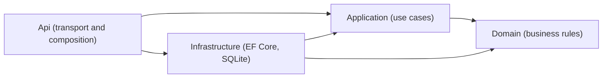
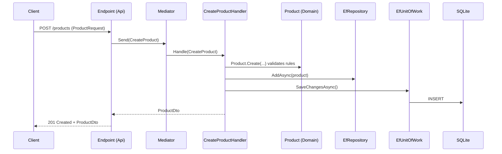

# Architecture and Onboarding Guide: AulaPedidos

> 🌐 Language: **English** | [Español](ARCHITECTURE.md)
>
> Training guide for new team members.
> Stack: **.NET 10**, **ASP.NET Core Minimal APIs**, **EF Core (SQLite)** and **Mediator** (martinothamar).

## Table of Contents

1. [Purpose of this guide](#1-purpose-of-this-guide)
2. [Solution overview](#2-solution-overview)
3. [Layered architecture (Clean Architecture)](#3-layered-architecture-clean-architecture)
4. [The projects, one by one](#4-the-projects-one-by-one)
5. [Applied patterns](#5-applied-patterns)
6. [Full request flow](#6-full-request-flow)
7. [How to add a new feature](#7-how-to-add-a-new-feature-step-by-step)
8. [Testing strategy](#8-testing-strategy)
9. [Team conventions and best practices](#9-team-conventions-and-best-practices)
10. [Common commands](#10-common-commands)
11. [Common mistakes](#11-common-mistakes)
12. [Glossary](#12-glossary)
13. [Practical exercises](#13-practical-exercises)
14. [Recommended reading](#14-recommended-reading)

---

## 1. Purpose of this guide

After reading it you should be able to:

- Explain what each project does and why it exists.
- Know which layer each piece of code belongs to.
- Recognize the patterns in use and apply them.
- Add a new use case end to end.
- Understand the team's technical vocabulary (see the [Glossary](#12-glossary)).

---

## 2. Solution overview

Solution file: `CursoNETIA.slnx` (Visual Studio's XML solution format).

```text
CursoNetIA/
├── CursoNETIA.slnx
├── ARCHITECTURE.md                   # Spanish version
├── ARCHITECTURE.en.md                # English version
├── .github/
│   └── copilot-instructions.md
├── docs/
├── src/
│   ├── AulaPedidos.Domain/           # Business rules
│   ├── AulaPedidos.Application/      # Use cases and contracts
│   ├── AulaPedidos.Infrastructure/   # EF Core, repositories, Unit of Work
│   └── AulaPedidos.Api/              # Minimal APIs, composition, HTTP errors
└── tests/
	├── AulaPedidos.Application.Tests/
	├── AulaPedidos.Infrastructure.Tests/
	├── AulaPedidos.Api.IntegrationTests/
	└── AulaPedidos.ArchitectureTests/
```

Today the implemented functionality is the **product catalog** (`Product`), with full CRUD exposed under `/products`.

---

## 3. Layered architecture (Clean Architecture)

### 3.1 Core idea

> **Dependencies point inward.** The business (Domain) knows nothing about anyone else. Technical details (database, HTTP) plug in from the outside.



### 3.2 Dependency rules

| Project | May reference | Must NOT reference |
|---|---|---|
| Domain | Nothing | Application, Infrastructure, Api, EF Core, HTTP |
| Application | Domain | Infrastructure, Api, EF Core |
| Infrastructure | Application, Domain | Api |
| Api | Application, Infrastructure | (it is the composition root) |

The `AulaPedidos.ArchitectureTests` project is intended to enforce these rules automatically.

### 3.3 Why this architecture?

- **Testability:** domain and use cases are tested without a database or HTTP.
- **Replaceability:** you can swap SQLite for another engine by touching only Infrastructure.
- **Clarity:** everything has exactly one place to live.
- **Business protection:** rules are not polluted by technical details.

---

## 4. The projects, one by one

### 4.1 `AulaPedidos.Domain`

**Responsibility:** entities and business rules. **Dependencies:** none.

**Real example: `Product`**

```csharp
public sealed class Product
{
	public const int MaximumDescriptionLength = 200;

	private Product() { }                         // Only created via Create (and EF Core)

	public Guid Id { get; private set; }
	public decimal Price { get; private set; }
	public string Description { get; private set; } = string.Empty;
	public string? AlternateDescription { get; private set; }

	public static Product Create(decimal price, string? description, string? alternateDescription)
	{
		var product = new Product();
		product.Update(price, description, alternateDescription);
		product.Id = Guid.NewGuid();
		return product;
	}

	public void Update(decimal price, string? description, string? alternateDescription)
	{
		// Normalizes and validates. Throws ProductValidationException if something is invalid.
	}
}
```

Key points:

- **Private constructor + `Create` factory:** an invalid product cannot be built.
- **Private setters:** state only changes through domain methods.
- **Validation inside the entity:** description is required (max 200 characters), alternate description is optional (max 200) and price must not be negative.
- **`ProductValidationException`:** a domain exception that the Api layer translates to HTTP 400.
- The `Id` (`Guid`) is generated in the domain, not by the database.

### 4.2 `AulaPedidos.Application`

**Responsibility:** orchestrate use cases and define the contracts it needs.
**Dependencies:** `Domain`, `Mediator.Abstractions`, `Microsoft.Extensions.DependencyInjection.Abstractions`.

| Element | Location | Role |
|---|---|---|
| `IRepository<TEntity>` | `Contracts/Persistence` | Data access contract |
| `IUnitOfWork` | `Contracts/Persistence` | Contract to commit changes |
| `CreateProduct`, `UpdateProduct`, `DeleteProduct` | `Products` | Commands and their handlers |
| `GetProducts`, `GetProductById` | `Products` | Queries and their handlers |
| `ProductDto` | `Products` | Data transfer object |
| `DependencyInjection` | root | `AddApplication()` |

### 4.3 `AulaPedidos.Infrastructure`

**Responsibility:** implement Application's contracts with concrete technology.
**Dependencies:** `Application`, `Domain`, `EF Core`, `EF Core Sqlite`.

- `AulaPedidosDbContext`: EF Core context. Exposes `DbSet<Product>` and applies the configurations.
- `ProductConfiguration`: `IEntityTypeConfiguration<Product>` using Fluent API (table `Products`, `Id` key without auto-generation, `Price` with precision 18,2, required `Description` with a maximum of 200).
- `EfRepository<TEntity>`: generic implementation of `IRepository<TEntity>`.
- `EfUnitOfWork`: delegates to `DbContext.SaveChangesAsync`.
- `DependencyInjection.AddInfrastructure(configuration)`: registers everything.

The connection string is read from `ConnectionStrings:AulaPedidos`. If it does not exist, it uses `Data Source=aulapedidos.db`.

### 4.4 `AulaPedidos.Api`

**Responsibility:** expose HTTP and compose the application. **It contains no business logic.**
**Dependencies:** `Application`, `Infrastructure`, `Mediator.SourceGenerator`, OpenAPI, EF Core Design (migrations).

- `Program.cs`: composition root.
- `Endpoints/ProductEndpoints.cs`: `/products` routes.
- `Errors/ProductValidationExceptionHandler.cs`: converts domain exceptions into `ProblemDetails`.
- `public partial class Program;`: required by `WebApplicationFactory` in integration tests.

### 4.5 Test projects

| Project | What it tests |
|---|---|
| `AulaPedidos.Application.Tests` | Use case handlers |
| `AulaPedidos.Infrastructure.Tests` | Repositories and persistence |
| `AulaPedidos.Api.IntegrationTests` | The API end to end |
| `AulaPedidos.ArchitectureTests` | Structure and dependencies between layers (xUnit) |

---

## 5. Applied patterns

### 5.1 Clean Architecture

**What it is:** organizing code in layers where dependencies point toward the domain.
**Where you see it:** the structure of the four projects in `src/`.
**Example:** `Application` defines `IRepository<T>` without knowing EF Core exists; `Infrastructure` implements it.
**When to apply it:** always. Every new type must be placed according to its responsibility.

### 5.2 Dependency Inversion Principle (DIP) and Dependency Injection (DI)

**What it is:** high-level modules depend on abstractions. Dependencies are received through the constructor.

```csharp
// Application: depends on the ABSTRACTION
public sealed class CreateProductHandler(IRepository<Product> repository, IUnitOfWork unitOfWork)
	: ICommandHandler<CreateProduct, ProductDto> { /* ... */ }

// Infrastructure: registers the IMPLEMENTATION
services.AddScoped(typeof(IRepository<>), typeof(EfRepository<>));
services.AddScoped<IUnitOfWork, EfUnitOfWork>();
```

**Benefit:** in tests you can inject a test double instead of EF Core.

### 5.3 Composition Root

**What it is:** a single place where all the pieces are wired together.
**Where you see it:** `Program.cs`.

```csharp
builder.Services.AddMediator(options =>
{
	options.Assemblies = [typeof(AulaPedidos.Application.DependencyInjection).Assembly];
	options.ServiceLifetime = ServiceLifetime.Scoped;
});
builder.Services.AddApplication();
builder.Services.AddInfrastructure(builder.Configuration);
```

**Rule:** only `Api` should know the concrete implementations.

### 5.4 Per-layer DI extensions

Each layer exposes an `AddXxx` method that registers its own services.

```csharp
public static IServiceCollection AddApplication(this IServiceCollection services) { /* ... */ }
public static IServiceCollection AddInfrastructure(this IServiceCollection services, IConfiguration configuration) { /* ... */ }
```

**Benefit:** `Program.cs` stays short and each layer controls its own registration.

### 5.5 Mediator + lightweight CQRS

- **Mediator:** an intermediary between whoever asks for something (endpoint) and whoever runs it (handler).
- **CQRS:** separate operations that **change** state (*commands*) from those that only **read** (*queries*).

**Library:** [Mediator](https://github.com/martinothamar/Mediator) by martinothamar (*source generators*, no reflection). **MediatR and a custom mediator are NOT used.**

```csharp
// 1. Message (command): immutable record
public sealed record CreateProduct(decimal Price, string? Description, string? AlternateDescription)
	: ICommand<ProductDto>;

// 2. Handler: contains the use case
public sealed class CreateProductHandler(IRepository<Product> repository, IUnitOfWork unitOfWork)
	: ICommandHandler<CreateProduct, ProductDto>
{
	public async ValueTask<ProductDto> Handle(CreateProduct command, CancellationToken cancellationToken)
	{
		cancellationToken.ThrowIfCancellationRequested();
		var product = Product.Create(command.Price, command.Description, command.AlternateDescription);
		await repository.AddAsync(product, cancellationToken);
		_ = await unitOfWork.SaveChangesAsync(cancellationToken);
		return ProductDto.FromProduct(product);
	}
}

// 3. Endpoint: only sends the message
var product = await sender.Send(new CreateProduct(...), cancellationToken);
```

| Type | Interfaces | Examples |
|---|---|---|
| Command (write) | `ICommand<T>` / `ICommandHandler<,>` | `CreateProduct`, `UpdateProduct`, `DeleteProduct` |
| Query (read) | `IQuery<T>` / `IQueryHandler<,>` | `GetProducts`, `GetProductById` |

Rules observed in the code:

- **Query** handlers only inject `IRepository<T>`; **command** handlers also inject `IUnitOfWork`.
- `Handle` returns `ValueTask`, not `Task`.
- If a resource does not exist, the handler returns `null` or `false` (it does not throw) and the endpoint translates that to 404.

### 5.6 Repository

**What it is:** an abstraction that behaves like a collection of entities and hides how they are stored.

```csharp
public interface IRepository<TEntity> where TEntity : class
{
	Task<TEntity?> FirstOrDefaultAsync(Expression<Func<TEntity, bool>> predicate, CancellationToken ct = default);
	Task<IReadOnlyList<TEntity>> ListAsync(Expression<Func<TEntity, bool>> predicate, CancellationToken ct = default);
	Task<bool> AnyAsync(Expression<Func<TEntity, bool>> predicate, CancellationToken ct = default);
	Task<int> CountAsync(Expression<Func<TEntity, bool>> predicate, CancellationToken ct = default);
	Task AddAsync(TEntity entity, CancellationToken ct = default);
	Task RemoveAsync(TEntity entity, CancellationToken ct = default);
}
```

**Implementation:** `EfRepository<TEntity>` delegates to `DbSet<TEntity>`.

Notes:

- It is **generic**: a single contract and a single implementation serve every entity.
- `AddAsync` and `RemoveAsync` **do not persist**: they only mark the change. The Unit of Work commits it.
- **There is no `Update` method.** EF Core tracks (*change tracking*) loaded entities: it is enough to modify them through domain methods and call `SaveChangesAsync`. This is how `UpdateProductHandler` works.
- Filters are `Expression<Func<...>>` and EF Core translates them to SQL. Do not use custom methods EF cannot translate.
- `GetProducts` uses `ListAsync(_ => true)`: it lists everything without paging. With lots of data you would need to add pagination.

```csharp
var exists = await repository.AnyAsync(p => p.Description == "Keyboard", cancellationToken);
```

### 5.7 Unit of Work

**What it is:** groups several changes and commits them together.

```csharp
public interface IUnitOfWork
{
	Task<int> SaveChangesAsync(CancellationToken cancellationToken = default);
}

public sealed class EfUnitOfWork(AulaPedidosDbContext dbContext) : IUnitOfWork
{
	public Task<int> SaveChangesAsync(CancellationToken cancellationToken = default) =>
		dbContext.SaveChangesAsync(cancellationToken);
}
```

**Rule:** **every command that modifies data must end with `SaveChangesAsync`.** If you forget it, nothing is saved and there is no error.

### 5.8 Rich domain entity

**What it is:** the entity contains data **and** behavior, and protects its invariants.

```csharp
product.Price = -5;                       // Bad (anemic): nothing prevents it
product.Update(-5, "Keyboard", null);     // Good: throws ProductValidationException
```

Made possible by: private constructor, private setters, `Create` factory and an `Update` method with validation.

### 5.9 Factory Method

A static method that creates objects while guaranteeing they are valid: `Product.Create(10m, "Keyboard", null)`.

### 5.10 DTO

A simple object used to carry data between layers without exposing the entity.

```csharp
public sealed record ProductDto(Guid Id, decimal Price, string Description, string? AlternateDescription)
{
	public static ProductDto FromProduct(Product product) =>
		new(product.Id, product.Price, product.Description, product.AlternateDescription);
}
```

The API never returns `Product` directly. In addition, `ProductRequest` (in Api) models the request body.

### 5.11 Minimal APIs with endpoint groups

```csharp
var group = endpoints.MapGroup("/products").WithTags("Products");

group.MapGet("/{id:guid}", async Task<Results<Ok<ProductDto>, NotFound>> (
	Guid id, ISender sender, CancellationToken cancellationToken) =>
{
	var product = await sender.Send(new GetProductById(id), cancellationToken);
	return product is null ? TypedResults.NotFound() : TypedResults.Ok(product);
});
```

Visible good practices: `MapGroup`, `TypedResults` and `Results<...>` (explicit responses and better OpenAPI), the `{id:guid}` constraint, a `CancellationToken` on every endpoint and no business logic.

| Verb | Route | Use case | Responses |
|---|---|---|---|
| POST | `/products` | `CreateProduct` | 201, 400 |
| GET | `/products` | `GetProducts` | 200 |
| GET | `/products/{id}` | `GetProductById` | 200, 404 |
| PUT | `/products/{id}` | `UpdateProduct` | 200, 400, 404 |
| DELETE | `/products/{id}` | `DeleteProduct` | 204, 404 |

### 5.12 Global exception handling and Problem Details (RFC 7807)

```csharp
public sealed class ProductValidationExceptionHandler(IProblemDetailsService problemDetailsService)
	: IExceptionHandler
{
	public async ValueTask<bool> TryHandleAsync(HttpContext httpContext, Exception exception, CancellationToken ct)
	{
		if (exception is not ProductValidationException) return false;   // Not mine: continue the chain

		httpContext.Response.StatusCode = StatusCodes.Status400BadRequest;
		return await problemDetailsService.TryWriteAsync(new ProblemDetailsContext
		{
			HttpContext = httpContext,
			ProblemDetails = new ProblemDetails
			{
				Status = StatusCodes.Status400BadRequest,
				Title = "Invalid product",
				Detail = exception.Message,
			},
		});
	}
}
```

Registration:

```csharp
builder.Services.AddProblemDetails();
builder.Services.AddExceptionHandler<ProductValidationExceptionHandler>();
app.UseExceptionHandler();
```

**Rule:** the domain never returns HTTP codes. It throws its own exceptions and the Api layer translates them.

### 5.13 Convention-based configuration

```csharp
var connectionString = configuration.GetConnectionString("AulaPedidos");
if (string.IsNullOrWhiteSpace(connectionString))
	connectionString = "Data Source=aulapedidos.db";
```

**Security:** never store secrets or production connection strings in the repository. Use *User Secrets* locally and environment variables or a secret manager in other environments.

### 5.14 Entity configuration with Fluent API

`ProductConfiguration` implements `IEntityTypeConfiguration<Product>`. It keeps the domain free of EF attributes and centralizes the mapping in Infrastructure.

```csharp
builder.ToTable("Products");
builder.HasKey(product => product.Id);
builder.Property(product => product.Id).ValueGeneratedNever();
builder.Property(product => product.Price).HasPrecision(18, 2);
builder.Property(product => product.Description).IsRequired().HasMaxLength(Product.MaximumDescriptionLength);
```

Notice that it reuses `Product.MaximumDescriptionLength`: the rule lives in a single place.

### 5.15 Automatic migrations at startup

```csharp
await using (var scope = app.Services.CreateAsyncScope())
{
	var dbContext = scope.ServiceProvider.GetRequiredService<AulaPedidosDbContext>();
	await dbContext.Database.MigrateAsync(app.Lifetime.ApplicationStopping);
}
```

Convenient for development and training. **Caution:** in production with several instances it can cause race conditions; consider running migrations as a separate deployment step.

### 5.16 Health Checks and OpenAPI

- `app.MapHealthChecks("/health")`: health endpoint.
- `AddOpenApi()` / `MapOpenApi()`: OpenAPI document, only in Development.

### 5.17 Architecture Tests

Automated tests that verify the structure of the code (for example, that `Domain` does not depend on `Infrastructure`). They protect the architecture from silent erosion.

### 5.18 Asynchronous programming with `CancellationToken`

- All I/O is `async`/`await`.
- `CancellationToken` is propagated from the endpoint down to the repository.
- `.Result` and `.Wait()` are **forbidden**.

### 5.19 Immutable records

```csharp
public sealed record CreateProduct(decimal Price, string? Description, string? AlternateDescription)
	: ICommand<ProductDto>;
```

Immutable, with value equality and concise: ideal for messages and DTOs.

### Summary table

| Pattern | Main layer | Reference file |
|---|---|---|
| Clean Architecture | All | `src/` structure |
| DIP / DI | All | Handler constructors |
| Composition Root | Api | `Program.cs` |
| DI extensions | Application, Infrastructure | `DependencyInjection.cs` |
| Mediator + CQRS | Application | `CreateProduct.cs`, `GetProducts.cs` |
| Repository | Application / Infrastructure | `IRepository.cs`, `EfRepository.cs` |
| Unit of Work | Application / Infrastructure | `IUnitOfWork.cs`, `EfUnitOfWork.cs` |
| Rich entity / Factory Method | Domain | `Product.cs` |
| DTO | Application | `ProductDto.cs` |
| Fluent API (EF) | Infrastructure | `ProductConfiguration.cs` |
| Minimal APIs | Api | `ProductEndpoints.cs` |
| Problem Details | Api | `ProductValidationExceptionHandler.cs` |
| Architecture Tests | Tests | `AulaPedidos.ArchitectureTests` |

---

## 6. Full request flow

Example: `POST /products`.



**Error path:**

1. `Product.Create` throws `ProductValidationException`.
2. The exception bubbles up through the handler and Mediator to the middleware.
3. `ProductValidationExceptionHandler` responds `400` with `ProblemDetails`.

---

## 7. How to add a new feature (step by step)

Example: **`Customer` entity** with customer creation.

### Step 1. Domain

```csharp
// src/AulaPedidos.Domain/Customers/Customer.cs
namespace AulaPedidos.Domain.Customers;

public sealed class Customer
{
	private Customer() { }

	public Guid Id { get; private set; }
	public string Name { get; private set; } = string.Empty;

	public static Customer Create(string? name)
	{
		if (string.IsNullOrWhiteSpace(name))
			throw new CustomerValidationException("Name is required.");

		return new Customer { Id = Guid.NewGuid(), Name = name.Trim() };
	}
}

public sealed class CustomerValidationException(string message) : Exception(message);
```

### Step 2. Application

```csharp
// src/AulaPedidos.Application/Customers/CreateCustomer.cs
public sealed record CustomerDto(Guid Id, string Name);

public sealed record CreateCustomer(string? Name) : ICommand<CustomerDto>;

public sealed class CreateCustomerHandler(IRepository<Customer> repository, IUnitOfWork unitOfWork)
	: ICommandHandler<CreateCustomer, CustomerDto>
{
	public async ValueTask<CustomerDto> Handle(CreateCustomer command, CancellationToken cancellationToken)
	{
		var customer = Customer.Create(command.Name);
		await repository.AddAsync(customer, cancellationToken);
		_ = await unitOfWork.SaveChangesAsync(cancellationToken);
		return new CustomerDto(customer.Id, customer.Name);
	}
}
```

### Step 3. Infrastructure

1. Add `public DbSet<Customer> Customers => Set<Customer>();` to `AulaPedidosDbContext`.
2. Create `CustomerConfiguration : IEntityTypeConfiguration<Customer>` and apply it in `OnModelCreating`.
3. Create the migration:

```powershell
dotnet ef migrations add AddCustomers --project src/AulaPedidos.Infrastructure --startup-project src/AulaPedidos.Api
```

You do not need to register a new repository: `EfRepository<>` is generic.

### Step 4. Api

```csharp
group.MapPost("/", async Task<Created<CustomerDto>> (CustomerRequest request, ISender sender, CancellationToken ct) =>
{
	var customer = await sender.Send(new CreateCustomer(request.Name), ct);
	return TypedResults.Created($"/customers/{customer.Id}", customer);
});
```

Register `MapCustomerEndpoints()` in `Program.cs` and add handling of `CustomerValidationException` in an `IExceptionHandler`.

### Step 5. Tests

- Application: unit test of the handler.
- Infrastructure: test of the repository and the configuration.
- Api: integration test of the endpoint (201/400/404).
- Run `dotnet test CursoNETIA.slnx`.

### Checklist before opening a PR

- [ ] The business rule is in Domain, not in the endpoint.
- [ ] The command handler calls `SaveChangesAsync`.
- [ ] All I/O is asynchronous and propagates `CancellationToken`.
- [ ] The API returns DTOs, never entities.
- [ ] The change has tests.
- [ ] `dotnet build CursoNETIA.slnx` and `dotnet test CursoNETIA.slnx` pass.
- [ ] There are no secrets or sensitive data in code or logs.

---

## 8. Testing strategy

| Level | Project | What it validates | Speed |
|---|---|---|---|
| Unit | `Application.Tests` | Handlers with doubles of `IRepository` and `IUnitOfWork` | Very fast |
| Persistence | `Infrastructure.Tests` | Real EF Core queries and mapping | Medium |
| Integration | `Api.IntegrationTests` | Full HTTP with `WebApplicationFactory<Program>` | Slower |
| Architecture | `ArchitectureTests` | Dependency rules between layers | Fast |

**Tip:** test each rule at the lowest possible level. A `Product` validation is verified with a unit test, not an integration test. The test framework is xUnit.

---

## 9. Team conventions and best practices

- Documentation and comments in Spanish; **code names in English**.
- Small changes consistent with existing conventions.
- Handlers orchestrate; rules live in the domain.
- Validate inputs and protect invariants.
- Do not introduce packages or patterns without a real need.
- Do not use MediatR or a custom mediator: **Mediator** (martinothamar) is used.
- Project utilities are written in C#, not in PowerShell scripts.
- Never log secrets or sensitive data.
- Respect `.editorconfig`.

---

## 10. Common commands

From the solution root:

```powershell
dotnet build CursoNETIA.slnx
dotnet test CursoNETIA.slnx
dotnet run --project src/AulaPedidos.Api
dotnet ef migrations add <Name> --project src/AulaPedidos.Infrastructure --startup-project src/AulaPedidos.Api
```

With the API running, check `GET /health`. In Development you also have the OpenAPI document.

---

## 11. Common mistakes

| Symptom | Likely cause | Fix |
|---|---|---|
| Data is not saved and there is no error | `SaveChangesAsync` is missing | Call `unitOfWork.SaveChangesAsync` |
| The handler is not found | Assembly not registered in `AddMediator` | Check `options.Assemblies` |
| An architecture test fails | Improper project reference | Remove the dependency or move the code |
| 500 instead of 400 | Domain exception without an `IExceptionHandler` | Add the matching HTTP handler |
| A repository filter fails at runtime | Expression cannot be translated to SQL | Simplify the expression |
| Requests hang | Use of `.Result` or `.Wait()` | Use `await` |
| A handler returning `Task` does not compile | Mediator requires `ValueTask` | Change the return type |
| A change to an entity is not persisted | The entity is not tracked or `SaveChangesAsync` is missing | Load it through the repository and save |

---

## 12. Glossary

| Term | Definition |
|---|---|
| **API** | Interface through which other systems interact with the application. |
| **Async / await** | C# model for non-blocking operations. |
| **Aggregate** | Group of entities treated as a unit of consistency with a root. |
| **Application (layer)** | Layer of use cases and contracts. |
| **Architecture Test** | Test that verifies structural rules of the code. |
| **Cancellation Token** | Object that allows cancelling in-progress asynchronous operations. |
| **Change Tracking** | EF Core mechanism that detects changes in loaded entities. |
| **Clean Architecture** | Architectural style with dependencies pointing toward the domain. |
| **Command** | Message that requests a state change. |
| **Composition Root** | Single place where dependencies are assembled (`Program.cs`). |
| **Contract** | Interface that defines what is offered without saying how. |
| **CQRS** | Separation between write operations (commands) and read operations (queries). |
| **CRUD** | Create, Read, Update, Delete. |
| **DbContext** | EF Core class that represents a session with the database. |
| **DbSet** | EF Core collection that represents a table. |
| **Dependency Inversion Principle (DIP)** | Depend on abstractions, not on concrete implementations. |
| **Dependency Injection (DI)** | Technique where dependencies are received from the outside. |
| **Domain (layer)** | Layer of entities and business rules. |
| **Domain Exception** | Exception specific to the domain (`ProductValidationException`). |
| **DTO** | Data Transfer Object between layers or to the client. |
| **EF Core** | Microsoft's ORM (Entity Framework Core). |
| **Endpoint** | HTTP route that serves requests. |
| **Entity** | Domain object with its own identity (`Id`). |
| **Anemic entity** | Entity with only data and no behavior. It is an anti-pattern. |
| **Rich entity** | Entity that contains data and rules. |
| **Expression Tree** | Representation of code as data that EF Core translates to SQL. |
| **Factory Method** | Method that creates objects guaranteeing their validity. |
| **Fluent API** | Configuration of the EF Core mapping through chained code. |
| **Handler** | Class that executes a command or query. |
| **Health Check** | Endpoint that reports the application's state. |
| **HTTP Status Code** | Numeric response code (200, 201, 400, 404, 500...). |
| **Idempotency** | Property where repeating an operation yields the same result. |
| **Infrastructure (layer)** | Layer of technical implementations. |
| **Integration Test** | Test that exercises several components together. |
| **Invariant** | Condition that must always hold in the domain. |
| **IExceptionHandler** | ASP.NET Core interface to handle exceptions globally. |
| **Mediator** | Pattern with an intermediary that decouples senders and receivers. |
| **Mediator (library)** | martinothamar's implementation based on *source generators*. |
| **Middleware** | HTTP pipeline component that processes requests and responses. |
| **Migration** | Versioned script that changes the database schema. |
| **Minimal API** | Lightweight way to define endpoints without controllers. |
| **Nullable Reference Types** | C# feature to avoid null-reference errors. |
| **OpenAPI** | Standard for describing HTTP APIs. |
| **ORM** | Object-relational mapper. |
| **Persistence** | Durable storage of data. |
| **Problem Details (RFC 7807)** | Standard JSON format for HTTP errors. |
| **Query** | Message that only reads data. |
| **Record** | Immutable C# type with value equality. |
| **Repository** | Pattern that abstracts data access as a collection. |
| **Request** | Model of an HTTP request body. |
| **Scoped (lifetime)** | One instance per HTTP request. |
| **Singleton / Transient** | One instance for the whole app / a new one on every resolution. |
| **Sealed** | Keyword that prevents inheriting from a class. |
| **Source Generator** | Compile-time code generator. |
| **SQLite** | Embedded relational database stored in a file. |
| **TypedResults** | Minimal APIs API for strongly typed responses. |
| **Unit of Work** | Pattern that groups changes and commits them together. |
| **Unit Test** | Isolated test of a small unit of code. |
| **Use Case** | Application flow that fulfils a goal (`CreateProduct`). |
| **Validation** | Checking that data meets the rules. |
| **Value Object** | Object without identity, defined by its values. |
| **ValueTask** | Lightweight alternative to `Task`, used by Mediator. |
| **WebApplicationFactory** | Utility to start the API in memory in integration tests. |
| **xUnit** | Testing framework used in the solution. |

---

## 13. Practical exercises

The exercises are ordered by difficulty and each one practices one or more patterns from [section 5](#5-applied-patterns). It is recommended to do them on your own branch and in order.

**General rules for all exercises:**

- Follow the conventions in [section 9](#9-team-conventions-and-best-practices) (English code names, `async`/`await`, `CancellationToken`).
- Write the test first whenever possible.
- When you finish each exercise, run `dotnet build CursoNETIA.slnx` and `dotnet test CursoNETIA.slnx`.
- Do not move on to the next exercise with failing tests.

| Level | Exercises | Patterns |
|---|---|---|
| Basic | 1 to 4 | Rich entity, Factory Method, DTO, Minimal APIs, Problem Details |
| Intermediate | 5 to 8 | Mediator, CQRS, Repository, Unit of Work, Fluent API, migrations |
| Advanced | 9 to 12 | Pipeline behaviors, pagination, architecture, concurrency and integration tests |

---

### Basic level

#### Exercise 1. New business rule in `Product`

**Patterns:** rich entity, domain exceptions.

**Statement:** the business decides that a product's `Description` cannot contain only digits (for example, `"12345"` is invalid).

**Tasks:**

1. Write a unit test that fails for `Product.Create(10m, "12345", null)`.
2. Implement the rule inside `Product.Update`.
3. Verify that `POST /products` with that description returns `400` with `ProblemDetails`.

**Acceptance criteria:**

- The rule lives **only** in `Domain`.
- `ProductValidationException` is thrown with a clear message.
- No endpoint or handler is modified.

**Hint:** `Update` is the only validation point; `Create` already reuses it.

---

#### Exercise 2. New field on the product

**Patterns:** rich entity, DTO, Fluent API, migrations.

**Statement:** add the optional field `Sku` (maximum 30 characters, no leading or trailing spaces).

**Tasks:**

1. Add `Sku` to `Product`, `Create` and `Update`, with its validation.
2. Update `ProductDto`, `ProductRequest` and the `CreateProduct` and `UpdateProduct` commands.
3. Configure the column in `ProductConfiguration` with `HasMaxLength`.
4. Generate a migration.
5. Add tests in every affected layer.

**Acceptance criteria:**

- The maximum length is defined in a domain constant and reused in the configuration.
- The migration applies without errors when the API starts.
- Existing products keep working (`Sku` is null).

**Hint:** follow the same path as `AlternateDescription`.

---

#### Exercise 3. Read-only endpoint

**Patterns:** Minimal APIs, `TypedResults`, DTO.

**Statement:** create `GET /products/count` that returns the total number of products.

**Tasks:**

1. Create the `GetProductsCount` query and its handler using `repository.CountAsync`.
2. Expose the endpoint with `TypedResults.Ok`.
3. Add an integration test.

**Acceptance criteria:**

- The handler does not inject `IUnitOfWork`.
- The `/count` route does not conflict with `/{id:guid}`.

**Reflection question:** why does the `{id:guid}` constraint avoid the conflict?

---

#### Exercise 4. Custom error handling

**Patterns:** Problem Details, `IExceptionHandler`.

**Statement:** create a domain exception `ProductNotSellableException` and map its result to `409 Conflict`.

**Tasks:**

1. Define the exception in `Domain`.
2. Create an `IExceptionHandler` in `Api` (or extend the existing one).
3. Register it in `Program.cs`.
4. Test that the response has `status: 409` and the expected `title`.

**Acceptance criteria:**

- `Domain` does not know HTTP codes.
- Existing handlers keep responding the same way (they return `false` if they do not handle the exception).

---

### Intermediate level

#### Exercise 5. New use case with Mediator (`CQRS`)

**Patterns:** Mediator, command, Repository, Unit of Work.

**Statement:** implement `ChangeProductPrice` with `PATCH /products/{id}/price`.

**Tasks:**

1. Add the method `Product.ChangePrice(decimal newPrice)` to the domain with validation (not negative).
2. Create the command `ChangeProductPrice(Guid Id, decimal Price) : ICommand<ProductDto?>` and its handler.
3. Expose the endpoint with `204`, `404` and `400` as appropriate.
4. Test the handler with doubles of `IRepository<Product>` and `IUnitOfWork`.

**Acceptance criteria:**

- The handler calls `SaveChangesAsync` **only once**.
- If the product does not exist, it returns `null` and saves nothing.
- The price rule is in the domain, not in the handler.

**Hint:** reuse the pattern of `UpdateProductHandler`.

---

#### Exercise 6. A complete new entity (`Customer`)

**Patterns:** Clean Architecture, generic Repository, Fluent API, migrations.

**Statement:** implement the CRUD for `Customer` (`Name` required, maximum 100; `Email` required with a valid format) following [section 7](#7-how-to-add-a-new-feature-step-by-step).

**Tasks:**

1. Domain: entity, factory and `CustomerValidationException`.
2. Application: four use cases plus `CustomerDto`.
3. Infrastructure: `DbSet`, Fluent API configuration (unique index on `Email`) and migration.
4. Api: `/customers` endpoint group and error handling.
5. Tests in the four test projects.

**Acceptance criteria:**

- **No** new repository is created: `EfRepository<>` is reused.
- A duplicate email returns `409`.
- Architecture tests stay green.

---

#### Exercise 7. Unit of Work with several operations

**Patterns:** Unit of Work, atomicity.

**Statement:** create the command `DuplicateProduct(Guid Id)` that creates a copy of the product with the description `"<original> (copy)"` and saves it.

**Tasks:**

1. Implement the handler: load the original, create the copy with `Product.Create` and add it.
2. Commit with a single `SaveChangesAsync`.
3. Write a test verifying that, if the resulting description exceeds 200 characters, **nothing** is saved and `ProductValidationException` propagates.

**Acceptance criteria:**

- No intermediate state is persisted.
- The maximum length is validated in the domain, not in the handler.

**Reflection question:** what would happen if the handler called `SaveChangesAsync` before creating the copy?

---

#### Exercise 8. Query with filters

**Patterns:** Repository with `Expression`, CQRS (query).

**Statement:** extend `GetProducts` to accept the optional filters `minPrice`, `maxPrice` and `text` (searches `Description`).

**Tasks:**

1. Change the query to `GetProducts(decimal? MinPrice, decimal? MaxPrice, string? Text)`.
2. Build the predicate as an `Expression<Func<Product, bool>>`.
3. Expose the filters as query-string parameters on the endpoint.
4. Test against the real database in `Infrastructure.Tests` that the filter is translated to SQL.

**Acceptance criteria:**

- Filtering happens in the database, not in memory (do not use `ToList()` before filtering).
- Without filters, the original behavior is preserved.

**Hint:** if a filter is not translated to SQL, EF Core throws an exception at runtime. Simplify the expression.

---

### Advanced level

#### Exercise 9. Pagination

**Patterns:** CQRS, DTO, Repository.

**Statement:** `GetProducts` currently lists everything. Add pagination (`page`, `pageSize`) and return a `PagedResult<ProductDto>` with `Items`, `Page`, `PageSize` and `TotalCount`.

**Tasks:**

1. Decide how to extend `IRepository<T>` without breaking existing consumers (for example, a new `ListPagedAsync` method with explicit ordering).
2. Implement the method in `EfRepository<T>`.
3. Validate `pageSize` (for example, maximum 100) and return `400` if it is invalid.
4. Test the edges: empty page, partial last page and excessive `pageSize`.

**Acceptance criteria:**

- The order is deterministic (for example, by `Description` and then `Id`).
- `Application` still does not depend on EF Core.

**Reflection question:** why is it dangerous to paginate without an explicit order?

---

#### Exercise 10. Logging pipeline behavior

**Patterns:** Mediator (pipeline), separation of concerns.

**Statement:** create an `IPipelineBehavior` that logs the name of the message and the execution time of every command and query.

**Tasks:**

1. Check the [Mediator](https://github.com/martinothamar/Mediator) documentation for *pipeline behavior* support.
2. Implement a generic logging behavior.
3. Register it with `AddMediator` (in `Api`, which is the composition root).
4. Verify that **no** sensitive data is logged (only the type name and the duration).

**Acceptance criteria:**

- No existing handler changes.
- If the handler throws, the behavior lets the exception propagate.
- The log does not include the content of the messages.

---

#### Exercise 11. New architecture rules

**Patterns:** Architecture Tests, Clean Architecture.

**Statement:** write tests that guarantee that:

1. `Domain` does not reference `Application`, `Infrastructure` or `Api`.
2. `Application` does not reference `Infrastructure` or `Api`.
3. All handlers are `sealed`.
4. Commands and queries are sealed `record`s and live in `Application`.

**Tasks:**

1. Use reflection over the assemblies (`Assembly.GetReferencedAssemblies()`) or an architecture-rules library if the team approves it.
2. Check that the tests **fail** when you deliberately introduce a violation (for example, by adding an improper reference in a throwaway branch).

**Acceptance criteria:**

- Every rule has an understandable error message.
- The tests run in a few seconds at most.

**Reflection question:** why does it matter that a test fails when it should fail?

---

#### Exercise 12. Concurrency and a full integration test

**Patterns:** Unit of Work, EF Core, integration tests.

**Statement:** two users edit the same product at the same time. Today the last one wins silently.

**Tasks:**

1. Add a concurrency token to `Product` (for example, a `Version` field configured with `IsConcurrencyToken` in `ProductConfiguration`).
2. Catch `DbUpdateConcurrencyException` and translate it to `409` through an `IExceptionHandler`.
3. Write an integration test with `WebApplicationFactory<Program>` that triggers the conflict.

**Acceptance criteria:**

- `Domain` does not depend on EF Core (the token is configured in Infrastructure).
- The conflict response is a `ProblemDetails`.
- The migration is generated and applied without breaking existing data.

**Hint:** SQLite does not generate `rowversion` automatically; decide how to update `Version` (for example, a new `Guid` on every change).

---

### Final self-assessment

Before considering yourself ready, check that you can answer these without consulting the guide:

- [ ] Which layer may reference which, and why?
- [ ] Where do I put a new business rule and where a new use case?
- [ ] What is the difference between a command and a query, and what does each handler inject?
- [ ] Why does `AddAsync` not save, and who does?
- [ ] Why does `UpdateProductHandler` not call any `Update` method on the repository?
- [ ] How is a domain exception turned into a `400`?
- [ ] What happens if I forget `SaveChangesAsync`?
- [ ] Why does the API return DTOs and not entities?
- [ ] What does an architecture test protect?
- [ ] How do I add a new entity without creating a new repository?

---

## 14. Recommended reading

- [Common web application architectures](https://learn.microsoft.com/dotnet/architecture/modern-web-apps-azure/common-web-application-architectures)
- [Minimal APIs in ASP.NET Core](https://learn.microsoft.com/aspnet/core/fundamentals/minimal-apis)
- [Error handling in ASP.NET Core](https://learn.microsoft.com/aspnet/core/fundamentals/error-handling)
- [EF Core: migrations](https://learn.microsoft.com/ef/core/managing-schemas/migrations/)
- [Integration tests in ASP.NET Core](https://learn.microsoft.com/aspnet/core/test/integration-tests)
- [Mediator (martinothamar)](https://github.com/martinothamar/Mediator)
- Domain-Driven Design, Eric Evans.
- Clean Architecture, Robert C. Martin.
