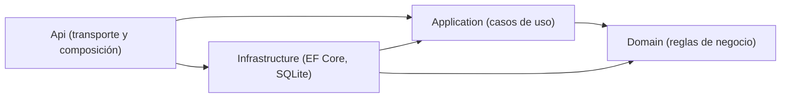
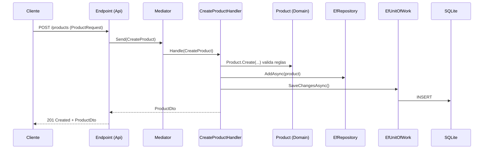

# Guía de arquitectura y onboarding: AulaPedidos

> 🌐 Idioma: **Español** | [English](ARCHITECTURE.en.md)
>
> Guía de formación para nuevos miembros del equipo.
> Stack: **.NET 10**, **ASP.NET Core Minimal APIs**, **EF Core (SQLite)** y **Mediator** (martinothamar).

## Índice

1. [Objetivo de esta guía](#1-objetivo-de-esta-guía)
2. [Visión general de la solución](#2-visión-general-de-la-solución)
3. [Arquitectura en capas (Clean Architecture)](#3-arquitectura-en-capas-clean-architecture)
4. [Los proyectos uno a uno](#4-los-proyectos-uno-a-uno)
5. [Patrones aplicados](#5-patrones-aplicados)
6. [Flujo completo de una petición](#6-flujo-completo-de-una-petición)
7. [Cómo añadir una nueva funcionalidad](#7-cómo-añadir-una-nueva-funcionalidad-paso-a-paso)
8. [Estrategia de pruebas](#8-estrategia-de-pruebas)
9. [Convenciones del equipo](#9-convenciones-y-buenas-prácticas-del-equipo)
10. [Comandos habituales](#10-comandos-habituales)
11. [Errores frecuentes](#11-errores-frecuentes)
12. [Glosario](#12-glosario)
13. [Ejercicios prácticos](#13-ejercicios-prácticos)
14. [Lecturas recomendadas](#14-lecturas-recomendadas)

---

## 1. Objetivo de esta guía

Al terminar de leerla deberías poder:

- Explicar qué hace cada proyecto y por qué existe.
- Saber en qué capa va cada pieza de código.
- Reconocer los patrones usados y aplicarlos.
- Añadir un caso de uso nuevo de extremo a extremo.
- Entender el vocabulario técnico del equipo (ver [Glosario](#12-glosario)).

---

## 2. Visión general de la solución

Archivo de solución: `CursoNETIA.slnx` (formato XML de soluciones de Visual Studio).

```text
CursoNetIA/
├── CursoNETIA.slnx
├── ARCHITECTURE.md                   # Versión en español
├── ARCHITECTURE.en.md                # Versión en inglés
├── .github/
│   └── copilot-instructions.md
├── docs/
├── src/
│   ├── AulaPedidos.Domain/           # Reglas de negocio
│   ├── AulaPedidos.Application/      # Casos de uso y contratos
│   ├── AulaPedidos.Infrastructure/   # EF Core, repositorios, Unit of Work
│   └── AulaPedidos.Api/              # Minimal APIs, composición, errores HTTP
└── tests/
	├── AulaPedidos.Application.Tests/
	├── AulaPedidos.Infrastructure.Tests/
	├── AulaPedidos.Api.IntegrationTests/
	└── AulaPedidos.ArchitectureTests/
```

Hoy la funcionalidad implementada es el **catálogo de productos** (`Product`), con CRUD completo expuesto en `/products`.

---

## 3. Arquitectura en capas (Clean Architecture)

### 3.1 Idea central

> **Las dependencias apuntan hacia el centro.** El negocio (Domain) no conoce a nadie. Los detalles técnicos (base de datos, HTTP) se conectan desde fuera.



### 3.2 Reglas de dependencia

| Proyecto | Puede referenciar | NO puede referenciar |
|---|---|---|
| Domain | Nada | Application, Infrastructure, Api, EF Core, HTTP |
| Application | Domain | Infrastructure, Api, EF Core |
| Infrastructure | Application, Domain | Api |
| Api | Application, Infrastructure | (es la raíz de composición) |

El proyecto `AulaPedidos.ArchitectureTests` está pensado para reforzar estas reglas automáticamente.

### 3.3 ¿Por qué esta arquitectura?

- **Testabilidad:** dominio y casos de uso se prueban sin base de datos ni HTTP.
- **Sustituibilidad:** puedes cambiar SQLite por otro motor tocando solo Infrastructure.
- **Claridad:** cada cosa tiene un único lugar donde vivir.
- **Protección del negocio:** las reglas no se contaminan con detalles técnicos.

---

## 4. Los proyectos uno a uno

### 4.1 `AulaPedidos.Domain`

**Responsabilidad:** entidades y reglas de negocio. **Dependencias:** ninguna.

**Ejemplo real: `Product`**

```csharp
public sealed class Product
{
	public const int MaximumDescriptionLength = 200;

	private Product() { }                         // Solo se crea vía Create (y EF Core)

	public Guid Id { get; private set; }
	public decimal Price { get; private set; }
	public string Description { get; private set; } = string.Empty;
	public string? AlternateDescription { get; private set; }

	public static Product Create(decimal price, string? description, string? alternateDescription)
	{
		var product = new Product();
		product.Update(price, description, alternateDescription);
		product.Id = Guid.NewGuid();
		return product;
	}

	public void Update(decimal price, string? description, string? alternateDescription)
	{
		// Normaliza y valida. Si algo es inválido, lanza ProductValidationException.
	}
}
```

Puntos clave:

- **Constructor privado + factoría `Create`:** no se puede construir un producto inválido.
- **Setters privados:** el estado solo cambia mediante métodos del dominio.
- **Validación dentro de la entidad:** descripción obligatoria (máximo 200 caracteres), alternativa opcional (máximo 200) y precio no negativo.
- **`ProductValidationException`:** excepción de dominio que la capa Api traduce a HTTP 400.
- El `Id` (`Guid`) se genera en el dominio, no en la base de datos.

### 4.2 `AulaPedidos.Application`

**Responsabilidad:** orquestar casos de uso y definir los contratos que necesita.
**Dependencias:** `Domain`, `Mediator.Abstractions`, `Microsoft.Extensions.DependencyInjection.Abstractions`.

| Elemento | Ubicación | Rol |
|---|---|---|
| `IRepository<TEntity>` | `Contracts/Persistence` | Contrato de acceso a datos |
| `IUnitOfWork` | `Contracts/Persistence` | Contrato para confirmar cambios |
| `CreateProduct`, `UpdateProduct`, `DeleteProduct` | `Products` | Comandos y sus handlers |
| `GetProducts`, `GetProductById` | `Products` | Consultas y sus handlers |
| `ProductDto` | `Products` | Objeto de transferencia de datos |
| `DependencyInjection` | raíz | `AddApplication()` |

### 4.3 `AulaPedidos.Infrastructure`

**Responsabilidad:** implementar los contratos de Application con tecnología concreta.
**Dependencias:** `Application`, `Domain`, `EF Core`, `EF Core Sqlite`.

- `AulaPedidosDbContext`: contexto de EF Core. Expone `DbSet<Product>` y aplica las configuraciones.
- `ProductConfiguration`: `IEntityTypeConfiguration<Product>` con Fluent API (tabla `Products`, clave `Id` sin generación automática, `Price` con precisión 18,2, `Description` obligatoria de máximo 200).
- `EfRepository<TEntity>`: implementación genérica de `IRepository<TEntity>`.
- `EfUnitOfWork`: delega en `DbContext.SaveChangesAsync`.
- `DependencyInjection.AddInfrastructure(configuration)`: registra todo.

La cadena de conexión se lee de `ConnectionStrings:AulaPedidos`. Si no existe, usa `Data Source=aulapedidos.db`.

### 4.4 `AulaPedidos.Api`

**Responsabilidad:** exponer HTTP y componer la aplicación. **No contiene lógica de negocio.**
**Dependencias:** `Application`, `Infrastructure`, `Mediator.SourceGenerator`, OpenAPI, EF Core Design (migraciones).

- `Program.cs`: raíz de composición.
- `Endpoints/ProductEndpoints.cs`: rutas `/products`.
- `Errors/ProductValidationExceptionHandler.cs`: convierte excepciones de dominio en `ProblemDetails`.
- `public partial class Program;`: necesario para `WebApplicationFactory` en pruebas de integración.

### 4.5 Proyectos de pruebas

| Proyecto | Qué prueba |
|---|---|
| `AulaPedidos.Application.Tests` | Handlers de casos de uso |
| `AulaPedidos.Infrastructure.Tests` | Repositorios y persistencia |
| `AulaPedidos.Api.IntegrationTests` | La API de extremo a extremo |
| `AulaPedidos.ArchitectureTests` | Estructura y dependencias entre capas (xUnit) |

---

## 5. Patrones aplicados

### 5.1 Clean Architecture

**Qué es:** organizar el código en capas donde las dependencias apuntan hacia el dominio.
**Dónde se ve:** la estructura de los cuatro proyectos de `src/`.
**Ejemplo:** `Application` define `IRepository<T>` sin saber que existe EF Core; `Infrastructure` lo implementa.
**Cuándo aplicarlo:** siempre. Todo tipo nuevo debe ubicarse según su responsabilidad.

### 5.2 Inversión de dependencias (DIP) e inyección de dependencias (DI)

**Qué es:** los módulos de alto nivel dependen de abstracciones. Las dependencias se reciben por constructor.

```csharp
// Application: depende de la ABSTRACCIÓN
public sealed class CreateProductHandler(IRepository<Product> repository, IUnitOfWork unitOfWork)
	: ICommandHandler<CreateProduct, ProductDto> { /* ... */ }

// Infrastructure: registra la IMPLEMENTACIÓN
services.AddScoped(typeof(IRepository<>), typeof(EfRepository<>));
services.AddScoped<IUnitOfWork, EfUnitOfWork>();
```

**Ventaja:** en pruebas puedes inyectar un doble en lugar de EF Core.

### 5.3 Composition Root

**Qué es:** un único lugar donde se conectan todas las piezas.
**Dónde se ve:** `Program.cs`.

```csharp
builder.Services.AddMediator(options =>
{
	options.Assemblies = [typeof(AulaPedidos.Application.DependencyInjection).Assembly];
	options.ServiceLifetime = ServiceLifetime.Scoped;
});
builder.Services.AddApplication();
builder.Services.AddInfrastructure(builder.Configuration);
```

**Regla:** solo `Api` debe conocer las implementaciones concretas.

### 5.4 Extensiones de DI por capa

Cada capa expone un método `AddXxx` que registra sus servicios.

```csharp
public static IServiceCollection AddApplication(this IServiceCollection services) { /* ... */ }
public static IServiceCollection AddInfrastructure(this IServiceCollection services, IConfiguration configuration) { /* ... */ }
```

**Ventaja:** `Program.cs` se mantiene corto y cada capa controla su registro.

### 5.5 Mediator + CQRS ligero

- **Mediator:** intermediario entre quien pide algo (endpoint) y quien lo ejecuta (handler).
- **CQRS:** separar operaciones que **cambian** estado (*comandos*) de las que solo **leen** (*consultas*).

**Librería:** [Mediator](https://github.com/martinothamar/Mediator) de martinothamar (*source generators*, sin reflexión). **No se usa MediatR ni un mediador propio.**

```csharp
// 1. Mensaje (comando): record inmutable
public sealed record CreateProduct(decimal Price, string? Description, string? AlternateDescription)
	: ICommand<ProductDto>;

// 2. Handler: contiene el caso de uso
public sealed class CreateProductHandler(IRepository<Product> repository, IUnitOfWork unitOfWork)
	: ICommandHandler<CreateProduct, ProductDto>
{
	public async ValueTask<ProductDto> Handle(CreateProduct command, CancellationToken cancellationToken)
	{
		cancellationToken.ThrowIfCancellationRequested();
		var product = Product.Create(command.Price, command.Description, command.AlternateDescription);
		await repository.AddAsync(product, cancellationToken);
		_ = await unitOfWork.SaveChangesAsync(cancellationToken);
		return ProductDto.FromProduct(product);
	}
}

// 3. Endpoint: solo envía el mensaje
var product = await sender.Send(new CreateProduct(...), cancellationToken);
```

| Tipo | Interfaces | Ejemplos |
|---|---|---|
| Comando (escritura) | `ICommand<T>` / `ICommandHandler<,>` | `CreateProduct`, `UpdateProduct`, `DeleteProduct` |
| Consulta (lectura) | `IQuery<T>` / `IQueryHandler<,>` | `GetProducts`, `GetProductById` |

Reglas observadas en el código:

- Los handlers de **consulta** solo inyectan `IRepository<T>`; los de **comando** inyectan además `IUnitOfWork`.
- `Handle` devuelve `ValueTask`, no `Task`.
- Si un recurso no existe, el handler devuelve `null` o `false` (no lanza excepción) y el endpoint lo traduce a 404.

### 5.6 Repository

**Qué es:** abstracción que simula una colección de entidades y oculta cómo se almacenan.

```csharp
public interface IRepository<TEntity> where TEntity : class
{
	Task<TEntity?> FirstOrDefaultAsync(Expression<Func<TEntity, bool>> predicate, CancellationToken ct = default);
	Task<IReadOnlyList<TEntity>> ListAsync(Expression<Func<TEntity, bool>> predicate, CancellationToken ct = default);
	Task<bool> AnyAsync(Expression<Func<TEntity, bool>> predicate, CancellationToken ct = default);
	Task<int> CountAsync(Expression<Func<TEntity, bool>> predicate, CancellationToken ct = default);
	Task AddAsync(TEntity entity, CancellationToken ct = default);
	Task RemoveAsync(TEntity entity, CancellationToken ct = default);
}
```

**Implementación:** `EfRepository<TEntity>` delega en `DbSet<TEntity>`.

Observaciones:

- Es **genérico**: un único contrato y una única implementación sirven a todas las entidades.
- `AddAsync` y `RemoveAsync` **no persisten**: solo marcan el cambio. Confirma el Unit of Work.
- **No existe método `Update`.** EF Core rastrea (*change tracking*) las entidades cargadas: basta con modificarlas mediante métodos del dominio y llamar a `SaveChangesAsync`. Así lo hace `UpdateProductHandler`.
- Los filtros son `Expression<Func<...>>` y EF Core los traduce a SQL. No uses métodos propios que EF no pueda traducir.
- `GetProducts` usa `ListAsync(_ => true)`: lista todo sin paginar. Con muchos datos habría que añadir paginación.

```csharp
var existe = await repository.AnyAsync(p => p.Description == "Teclado", cancellationToken);
```

### 5.7 Unit of Work

**Qué es:** agrupa varios cambios y los confirma de una vez.

```csharp
public interface IUnitOfWork
{
	Task<int> SaveChangesAsync(CancellationToken cancellationToken = default);
}

public sealed class EfUnitOfWork(AulaPedidosDbContext dbContext) : IUnitOfWork
{
	public Task<int> SaveChangesAsync(CancellationToken cancellationToken = default) =>
		dbContext.SaveChangesAsync(cancellationToken);
}
```

**Regla:** **todo comando que modifique datos debe terminar con `SaveChangesAsync`.** Si lo olvidas, no se guarda nada y no hay error.

### 5.8 Entidad rica de dominio

**Qué es:** la entidad contiene datos **y** comportamiento, y protege sus invariantes.

```csharp
product.Price = -5;                       // Mal (anémico): nadie lo impide
product.Update(-5, "Teclado", null);      // Bien: lanza ProductValidationException
```

Lo hacen posible: constructor privado, setters privados, factoría `Create` y método `Update` con validación.

### 5.9 Factory Method

Método estático que crea objetos garantizando que son válidos: `Product.Create(10m, "Teclado", null)`.

### 5.10 DTO

Objeto simple para transportar datos entre capas sin exponer la entidad.

```csharp
public sealed record ProductDto(Guid Id, decimal Price, string Description, string? AlternateDescription)
{
	public static ProductDto FromProduct(Product product) =>
		new(product.Id, product.Price, product.Description, product.AlternateDescription);
}
```

La API nunca devuelve `Product` directamente. Además, `ProductRequest` (en Api) modela el cuerpo de las peticiones.

### 5.11 Minimal APIs con grupos de endpoints

```csharp
var group = endpoints.MapGroup("/products").WithTags("Products");

group.MapGet("/{id:guid}", async Task<Results<Ok<ProductDto>, NotFound>> (
	Guid id, ISender sender, CancellationToken cancellationToken) =>
{
	var product = await sender.Send(new GetProductById(id), cancellationToken);
	return product is null ? TypedResults.NotFound() : TypedResults.Ok(product);
});
```

Buenas prácticas visibles: `MapGroup`, `TypedResults` y `Results<...>` (respuestas explícitas y mejor OpenAPI), restricción `{id:guid}`, `CancellationToken` en cada endpoint y ninguna lógica de negocio.

| Verbo | Ruta | Caso de uso | Respuestas |
|---|---|---|---|
| POST | `/products` | `CreateProduct` | 201, 400 |
| GET | `/products` | `GetProducts` | 200 |
| GET | `/products/{id}` | `GetProductById` | 200, 404 |
| PUT | `/products/{id}` | `UpdateProduct` | 200, 400, 404 |
| DELETE | `/products/{id}` | `DeleteProduct` | 204, 404 |

### 5.12 Manejo global de excepciones y Problem Details (RFC 7807)

```csharp
public sealed class ProductValidationExceptionHandler(IProblemDetailsService problemDetailsService)
	: IExceptionHandler
{
	public async ValueTask<bool> TryHandleAsync(HttpContext httpContext, Exception exception, CancellationToken ct)
	{
		if (exception is not ProductValidationException) return false;   // No es mío: sigue la cadena

		httpContext.Response.StatusCode = StatusCodes.Status400BadRequest;
		return await problemDetailsService.TryWriteAsync(new ProblemDetailsContext
		{
			HttpContext = httpContext,
			ProblemDetails = new ProblemDetails
			{
				Status = StatusCodes.Status400BadRequest,
				Title = "Invalid product",
				Detail = exception.Message,
			},
		});
	}
}
```

Registro:

```csharp
builder.Services.AddProblemDetails();
builder.Services.AddExceptionHandler<ProductValidationExceptionHandler>();
app.UseExceptionHandler();
```

**Regla:** el dominio nunca devuelve códigos HTTP. Lanza excepciones propias y la capa Api las traduce.

### 5.13 Configuración por convención

```csharp
var connectionString = configuration.GetConnectionString("AulaPedidos");
if (string.IsNullOrWhiteSpace(connectionString))
	connectionString = "Data Source=aulapedidos.db";
```

**Seguridad:** nunca guardes secretos ni cadenas de conexión de producción en el repositorio. Usa *User Secrets* en local y variables de entorno o un gestor de secretos en otros entornos.

### 5.14 Configuración de entidades con Fluent API

`ProductConfiguration` implementa `IEntityTypeConfiguration<Product>`. Mantiene el dominio libre de atributos de EF y centraliza el mapeo en Infrastructure.

```csharp
builder.ToTable("Products");
builder.HasKey(product => product.Id);
builder.Property(product => product.Id).ValueGeneratedNever();
builder.Property(product => product.Price).HasPrecision(18, 2);
builder.Property(product => product.Description).IsRequired().HasMaxLength(Product.MaximumDescriptionLength);
```

Observa que reutiliza `Product.MaximumDescriptionLength`: la regla vive en un solo sitio.

### 5.15 Migraciones automáticas al arrancar

```csharp
await using (var scope = app.Services.CreateAsyncScope())
{
	var dbContext = scope.ServiceProvider.GetRequiredService<AulaPedidosDbContext>();
	await dbContext.Database.MigrateAsync(app.Lifetime.ApplicationStopping);
}
```

Cómodo para desarrollo y formación. **Precaución:** en producción con varias instancias puede causar condiciones de carrera; considera ejecutar las migraciones como paso separado del despliegue.

### 5.16 Health Checks y OpenAPI

- `app.MapHealthChecks("/health")`: endpoint de salud.
- `AddOpenApi()` / `MapOpenApi()`: documento OpenAPI, solo en Development.

### 5.17 Architecture Tests

Pruebas automáticas que verifican la estructura del código (por ejemplo, que `Domain` no dependa de `Infrastructure`). Protegen la arquitectura de la erosión silenciosa.

### 5.18 Programación asíncrona con `CancellationToken`

- Todo I/O es `async`/`await`.
- Se propaga `CancellationToken` desde el endpoint hasta el repositorio.
- **Prohibido** `.Result` y `.Wait()`.

### 5.19 Records inmutables

```csharp
public sealed record CreateProduct(decimal Price, string? Description, string? AlternateDescription)
	: ICommand<ProductDto>;
```

Inmutables, con igualdad por valor y concisos: ideales para mensajes y DTOs.

### Tabla resumen

| Patrón | Capa principal | Archivo de referencia |
|---|---|---|
| Clean Architecture | Todas | Estructura de `src/` |
| DIP / DI | Todas | Constructores de handlers |
| Composition Root | Api | `Program.cs` |
| Extensiones de DI | Application, Infrastructure | `DependencyInjection.cs` |
| Mediator + CQRS | Application | `CreateProduct.cs`, `GetProducts.cs` |
| Repository | Application / Infrastructure | `IRepository.cs`, `EfRepository.cs` |
| Unit of Work | Application / Infrastructure | `IUnitOfWork.cs`, `EfUnitOfWork.cs` |
| Entidad rica / Factory Method | Domain | `Product.cs` |
| DTO | Application | `ProductDto.cs` |
| Fluent API (EF) | Infrastructure | `ProductConfiguration.cs` |
| Minimal APIs | Api | `ProductEndpoints.cs` |
| Problem Details | Api | `ProductValidationExceptionHandler.cs` |
| Architecture Tests | Tests | `AulaPedidos.ArchitectureTests` |

---

## 6. Flujo completo de una petición

Ejemplo: `POST /products`.



**Camino de error:**

1. `Product.Create` lanza `ProductValidationException`.
2. La excepción sube por el handler y el Mediator hasta el middleware.
3. `ProductValidationExceptionHandler` responde `400` con `ProblemDetails`.

---

## 7. Cómo añadir una nueva funcionalidad (paso a paso)

Ejemplo: **entidad `Customer`** con alta de cliente.

### Paso 1. Domain

```csharp
// src/AulaPedidos.Domain/Customers/Customer.cs
namespace AulaPedidos.Domain.Customers;

public sealed class Customer
{
	private Customer() { }

	public Guid Id { get; private set; }
	public string Name { get; private set; } = string.Empty;

	public static Customer Create(string? name)
	{
		if (string.IsNullOrWhiteSpace(name))
			throw new CustomerValidationException("Name is required.");

		return new Customer { Id = Guid.NewGuid(), Name = name.Trim() };
	}
}

public sealed class CustomerValidationException(string message) : Exception(message);
```

### Paso 2. Application

```csharp
// src/AulaPedidos.Application/Customers/CreateCustomer.cs
public sealed record CustomerDto(Guid Id, string Name);

public sealed record CreateCustomer(string? Name) : ICommand<CustomerDto>;

public sealed class CreateCustomerHandler(IRepository<Customer> repository, IUnitOfWork unitOfWork)
	: ICommandHandler<CreateCustomer, CustomerDto>
{
	public async ValueTask<CustomerDto> Handle(CreateCustomer command, CancellationToken cancellationToken)
	{
		var customer = Customer.Create(command.Name);
		await repository.AddAsync(customer, cancellationToken);
		_ = await unitOfWork.SaveChangesAsync(cancellationToken);
		return new CustomerDto(customer.Id, customer.Name);
	}
}
```

### Paso 3. Infrastructure

1. Añade `public DbSet<Customer> Customers => Set<Customer>();` en `AulaPedidosDbContext`.
2. Crea `CustomerConfiguration : IEntityTypeConfiguration<Customer>` y aplícala en `OnModelCreating`.
3. Crea la migración:

```powershell
dotnet ef migrations add AddCustomers --project src/AulaPedidos.Infrastructure --startup-project src/AulaPedidos.Api
```

No hace falta registrar un repositorio nuevo: `EfRepository<>` es genérico.

### Paso 4. Api

```csharp
group.MapPost("/", async Task<Created<CustomerDto>> (CustomerRequest request, ISender sender, CancellationToken ct) =>
{
	var customer = await sender.Send(new CreateCustomer(request.Name), ct);
	return TypedResults.Created($"/customers/{customer.Id}", customer);
});
```

Registra `MapCustomerEndpoints()` en `Program.cs` y añade el manejo de `CustomerValidationException` en un `IExceptionHandler`.

### Paso 5. Pruebas

- Application: prueba unitaria del handler.
- Infrastructure: prueba del repositorio y la configuración.
- Api: prueba de integración del endpoint (201/400/404).
- Ejecuta `dotnet test CursoNETIA.slnx`.

### Lista de comprobación antes de abrir un PR

- [ ] La regla de negocio está en Domain, no en el endpoint.
- [ ] El handler de comando llama a `SaveChangesAsync`.
- [ ] Todo I/O es asíncrono y propaga `CancellationToken`.
- [ ] La API devuelve DTOs, nunca entidades.
- [ ] Hay pruebas del cambio.
- [ ] `dotnet build CursoNETIA.slnx` y `dotnet test CursoNETIA.slnx` pasan.
- [ ] No hay secretos ni datos sensibles en código o logs.

---

## 8. Estrategia de pruebas

| Nivel | Proyecto | Qué valida | Velocidad |
|---|---|---|---|
| Unitaria | `Application.Tests` | Handlers con dobles de `IRepository` y `IUnitOfWork` | Muy rápida |
| Persistencia | `Infrastructure.Tests` | Consultas y mapeo EF Core reales | Media |
| Integración | `Api.IntegrationTests` | HTTP completo con `WebApplicationFactory<Program>` | Más lenta |
| Arquitectura | `ArchitectureTests` | Reglas de dependencia entre capas | Rápida |

**Consejo:** prueba cada regla en el nivel más bajo posible. Una validación de `Product` se verifica con una prueba unitaria, no con una de integración. El framework de pruebas es xUnit.

---

## 9. Convenciones y buenas prácticas del equipo

- Documentación y comentarios en español; **nombres de código en inglés**.
- Cambios pequeños y coherentes con las convenciones existentes.
- Los handlers orquestan; las reglas viven en el dominio.
- Valida entradas y protege invariantes.
- No introduzcas paquetes ni patrones sin necesidad real.
- No uses MediatR ni un mediador propio: se usa **Mediator** (martinothamar).
- Las utilidades del proyecto se escriben en C#, no en scripts de PowerShell.
- Nunca registres secretos ni datos sensibles en logs.
- Respeta `.editorconfig`.

---

## 10. Comandos habituales

Desde la raíz de la solución:

```powershell
dotnet build CursoNETIA.slnx
dotnet test CursoNETIA.slnx
dotnet run --project src/AulaPedidos.Api
dotnet ef migrations add <Nombre> --project src/AulaPedidos.Infrastructure --startup-project src/AulaPedidos.Api
```

Con la API en marcha, comprueba `GET /health`. En Development tienes el documento OpenAPI.

---

## 11. Errores frecuentes

| Síntoma | Causa probable | Solución |
|---|---|---|
| El dato no se guarda y no hay error | Falta `SaveChangesAsync` | Llamar a `unitOfWork.SaveChangesAsync` |
| El handler no se encuentra | Ensamblado no registrado en `AddMediator` | Revisar `options.Assemblies` |
| Falla una prueba de arquitectura | Referencia de proyecto indebida | Eliminar la dependencia o mover el código |
| 500 en vez de 400 | Excepción de dominio sin `IExceptionHandler` | Añadir el handler HTTP correspondiente |
| Un filtro del repositorio falla en ejecución | Expresión no traducible a SQL | Simplificar la expresión |
| Bloqueos en peticiones | Uso de `.Result` o `.Wait()` | Usar `await` |
| Un handler con `Task` no compila | Mediator exige `ValueTask` | Cambiar el tipo de retorno |
| Un cambio en una entidad no persiste | La entidad no está rastreada o falta `SaveChangesAsync` | Cargarla con el repositorio y guardar |

---

## 12. Glosario

| Término | Definición |
|---|---|
| **API** | Interfaz mediante la cual otros sistemas interactúan con la aplicación. |
| **Async / await** | Modelo de C# para operaciones no bloqueantes. |
| **Aggregate (agregado)** | Grupo de entidades tratadas como una unidad de consistencia con una raíz. |
| **Application (capa)** | Capa de casos de uso y contratos. |
| **Architecture Test** | Prueba que verifica reglas estructurales del código. |
| **Cancellation Token** | Objeto que permite cancelar operaciones asíncronas en curso. |
| **Change Tracking** | Mecanismo de EF Core que detecta cambios en entidades cargadas. |
| **Clean Architecture** | Estilo arquitectónico con dependencias hacia el dominio. |
| **Command (comando)** | Mensaje que solicita un cambio de estado. |
| **Composition Root** | Único lugar donde se ensamblan las dependencias (`Program.cs`). |
| **Contrato** | Interfaz que define qué se ofrece sin decir cómo. |
| **CQRS** | Separación entre operaciones de escritura (comandos) y lectura (consultas). |
| **CRUD** | Create, Read, Update, Delete. |
| **DbContext** | Clase de EF Core que representa una sesión con la base de datos. |
| **DbSet** | Colección de EF Core que representa una tabla. |
| **Dependency Inversion Principle (DIP)** | Depender de abstracciones, no de implementaciones concretas. |
| **Dependency Injection (DI)** | Técnica donde las dependencias se reciben desde fuera. |
| **Domain (capa)** | Capa de entidades y reglas de negocio. |
| **Domain Exception** | Excepción propia del dominio (`ProductValidationException`). |
| **DTO** | Objeto de transferencia de datos entre capas o hacia el cliente. |
| **EF Core** | ORM de Microsoft (Entity Framework Core). |
| **Endpoint** | Ruta HTTP que atiende peticiones. |
| **Entidad** | Objeto de dominio con identidad propia (`Id`). |
| **Entidad anémica** | Entidad solo con datos y sin comportamiento. Es un antipatrón. |
| **Entidad rica** | Entidad que contiene datos y reglas. |
| **Expression Tree** | Representación de código como datos que EF Core traduce a SQL. |
| **Factory Method** | Método que crea objetos garantizando su validez. |
| **Fluent API** | Configuración del mapeo de EF Core mediante código encadenado. |
| **Handler** | Clase que ejecuta un comando o consulta. |
| **Health Check** | Endpoint que informa del estado de la aplicación. |
| **HTTP Status Code** | Código numérico de respuesta (200, 201, 400, 404, 500...). |
| **Idempotencia** | Propiedad por la que repetir una operación produce el mismo resultado. |
| **Infrastructure (capa)** | Capa de implementaciones técnicas. |
| **Integration Test** | Prueba que ejercita varios componentes juntos. |
| **Invariante** | Condición que siempre debe cumplirse en el dominio. |
| **IExceptionHandler** | Interfaz de ASP.NET Core para tratar excepciones globalmente. |
| **Mediator** | Patrón con un intermediario que desacopla emisores y receptores. |
| **Mediator (librería)** | Implementación de martinothamar basada en *source generators*. |
| **Middleware** | Componente del pipeline HTTP que procesa peticiones y respuestas. |
| **Migración** | Script versionado que cambia el esquema de base de datos. |
| **Minimal API** | Forma ligera de definir endpoints sin controladores. |
| **Nullable Reference Types** | Característica de C# para evitar errores de referencia nula. |
| **OpenAPI** | Estándar para describir APIs HTTP. |
| **ORM** | Mapeador objeto-relacional. |
| **Persistencia** | Almacenamiento duradero de datos. |
| **Problem Details (RFC 7807)** | Formato estándar JSON para errores HTTP. |
| **Query (consulta)** | Mensaje que solo lee datos. |
| **Record** | Tipo C# inmutable con igualdad por valor. |
| **Repository** | Patrón que abstrae el acceso a los datos como una colección. |
| **Request** | Modelo del cuerpo de una petición HTTP. |
| **Scoped (ciclo de vida)** | Una instancia por petición HTTP. |
| **Singleton / Transient** | Una instancia para toda la app / una nueva en cada resolución. |
| **Sealed** | Palabra clave que impide heredar de una clase. |
| **Source Generator** | Generador de código en tiempo de compilación. |
| **SQLite** | Base de datos relacional embebida en un archivo. |
| **TypedResults** | API de Minimal APIs para respuestas tipadas. |
| **Unit of Work** | Patrón que agrupa cambios y los confirma juntos. |
| **Unit Test** | Prueba aislada de una unidad pequeña de código. |
| **Use Case (caso de uso)** | Flujo de la aplicación que cumple un objetivo (`CreateProduct`). |
| **Validación** | Comprobación de que los datos cumplen las reglas. |
| **Value Object** | Objeto sin identidad definido por sus valores. |
| **ValueTask** | Alternativa ligera a `Task`, usada por Mediator. |
| **WebApplicationFactory** | Utilidad para arrancar la API en memoria en pruebas de integración. |
| **xUnit** | Framework de pruebas usado en la solución. |

---

## 13. Ejercicios prácticos

Los ejercicios están ordenados por dificultad y cada uno practica uno o varios patrones de la [sección 5](#5-patrones-aplicados). Se recomienda hacerlos en una rama propia y en orden.

**Reglas generales para todos los ejercicios:**

- Sigue las convenciones de la [sección 9](#9-convenciones-y-buenas-prácticas-del-equipo) (nombres en inglés, `async`/`await`, `CancellationToken`).
- Escribe primero la prueba cuando sea posible.
- Al terminar cada ejercicio, ejecuta `dotnet build CursoNETIA.slnx` y `dotnet test CursoNETIA.slnx`.
- No pases al siguiente ejercicio con pruebas en rojo.

| Nivel | Ejercicios | Patrones |
|---|---|---|
| Básico | 1 a 4 | Entidad rica, Factory Method, DTO, Minimal APIs, Problem Details |
| Intermedio | 5 a 8 | Mediator, CQRS, Repository, Unit of Work, Fluent API, migraciones |
| Avanzado | 9 a 12 | Pipeline behaviors, paginación, arquitectura, concurrencia y pruebas de integración |

---

### Nivel básico

#### Ejercicio 1. Nueva regla de negocio en `Product`

**Patrones:** entidad rica, excepciones de dominio.

**Enunciado:** el negocio decide que la `Description` de un producto no puede contener solo dígitos (por ejemplo, `"12345"` es inválida).

**Tareas:**

1. Escribe una prueba unitaria que falle para `Product.Create(10m, "12345", null)`.
2. Implementa la regla dentro de `Product.Update`.
3. Verifica que `POST /products` con esa descripción devuelve `400` con `ProblemDetails`.

**Criterios de aceptación:**

- La regla vive **solo** en `Domain`.
- Se lanza `ProductValidationException` con un mensaje claro.
- No se modifica ningún endpoint ni handler.

**Pista:** `Update` es el único punto de validación; `Create` ya lo reutiliza.

---

#### Ejercicio 2. Nuevo campo en el producto

**Patrones:** entidad rica, DTO, Fluent API, migraciones.

**Enunciado:** añade el campo opcional `Sku` (máximo 30 caracteres, sin espacios al inicio ni al final).

**Tareas:**

1. Añade `Sku` a `Product`, a `Create` y a `Update`, con su validación.
2. Actualiza `ProductDto`, `ProductRequest` y los comandos `CreateProduct` y `UpdateProduct`.
3. Configura la columna en `ProductConfiguration` con `HasMaxLength`.
4. Genera una migración.
5. Añade pruebas en cada capa afectada.

**Criterios de aceptación:**

- La longitud máxima se define en una constante del dominio y se reutiliza en la configuración.
- La migración se aplica sin errores al arrancar la API.
- Los productos existentes siguen funcionando (`Sku` nulo).

**Pista:** sigue el mismo camino que `AlternateDescription`.

---

#### Ejercicio 3. Endpoint de solo lectura

**Patrones:** Minimal APIs, `TypedResults`, DTO.

**Enunciado:** crea `GET /products/count` que devuelve el número total de productos.

**Tareas:**

1. Crea la consulta `GetProductsCount` y su handler usando `repository.CountAsync`.
2. Expón el endpoint con `TypedResults.Ok`.
3. Añade una prueba de integración.

**Criterios de aceptación:**

- El handler no inyecta `IUnitOfWork`.
- La ruta `/count` no entra en conflicto con `/{id:guid}`.

**Pregunta de reflexión:** ¿por qué la restricción `{id:guid}` evita el conflicto?

---

#### Ejercicio 4. Manejo de errores propio

**Patrones:** Problem Details, `IExceptionHandler`.

**Enunciado:** crea una excepción de dominio `ProductNotSellableException` y mapea su resultado a `409 Conflict`.

**Tareas:**

1. Define la excepción en `Domain`.
2. Crea un `IExceptionHandler` en `Api` (o amplía el existente).
3. Regístralo en `Program.cs`.
4. Prueba que la respuesta tiene `status: 409` y el `title` esperado.

**Criterios de aceptación:**

- `Domain` no conoce códigos HTTP.
- Los handlers existentes siguen respondiendo igual (devuelven `false` si no manejan la excepción).

---

### Nivel intermedio

#### Ejercicio 5. Caso de uso nuevo con Mediator (`CQRS`)

**Patrones:** Mediator, comando, Repository, Unit of Work.

**Enunciado:** implementa `ChangeProductPrice` con `PATCH /products/{id}/price`.

**Tareas:**

1. Añade al dominio el método `Product.ChangePrice(decimal newPrice)` con validación (no negativo).
2. Crea el comando `ChangeProductPrice(Guid Id, decimal Price) : ICommand<ProductDto?>` y su handler.
3. Expón el endpoint con `204`, `404` y `400` según corresponda.
4. Prueba el handler con dobles de `IRepository<Product>` e `IUnitOfWork`.

**Criterios de aceptación:**

- El handler llama a `SaveChangesAsync` **una sola vez**.
- Si el producto no existe, devuelve `null` y no guarda nada.
- La regla del precio está en el dominio, no en el handler.

**Pista:** reutiliza el patrón de `UpdateProductHandler`.

---

#### Ejercicio 6. Nueva entidad completa (`Customer`)

**Patrones:** Clean Architecture, Repository genérico, Fluent API, migraciones.

**Enunciado:** implementa el CRUD de `Customer` (`Name` obligatorio, máximo 100; `Email` obligatorio con formato válido) siguiendo la [sección 7](#7-cómo-añadir-una-nueva-funcionalidad-paso-a-paso).

**Tareas:**

1. Dominio: entidad, factoría y excepción `CustomerValidationException`.
2. Application: cuatro casos de uso más `CustomerDto`.
3. Infrastructure: `DbSet`, configuración Fluent API (índice único para `Email`) y migración.
4. Api: grupo de endpoints `/customers` y manejo de errores.
5. Pruebas en los cuatro proyectos de pruebas.

**Criterios de aceptación:**

- **No** se crea un repositorio nuevo: se reutiliza `EfRepository<>`.
- Un correo duplicado devuelve `409`.
- Las pruebas de arquitectura siguen en verde.

---

#### Ejercicio 7. Unit of Work con varias operaciones

**Patrones:** Unit of Work, atomicidad.

**Enunciado:** crea el comando `DuplicateProduct(Guid Id)` que crea una copia del producto con la descripción `"<original> (copy)"` y la guarda.

**Tareas:**

1. Implementa el handler: carga el original, crea la copia con `Product.Create` y la añade.
2. Confirma con un único `SaveChangesAsync`.
3. Escribe una prueba que verifique que, si la descripción resultante supera 200 caracteres, **no** se guarda nada y se propaga `ProductValidationException`.

**Criterios de aceptación:**

- No hay estados intermedios persistidos.
- La longitud máxima se valida en el dominio, no en el handler.

**Pregunta de reflexión:** ¿qué pasaría si el handler llamara a `SaveChangesAsync` antes de crear la copia?

---

#### Ejercicio 8. Consulta con filtros

**Patrones:** Repository con `Expression`, CQRS (consulta).

**Enunciado:** amplía `GetProducts` para aceptar filtros opcionales `minPrice`, `maxPrice` y `text` (busca en `Description`).

**Tareas:**

1. Cambia la consulta a `GetProducts(decimal? MinPrice, decimal? MaxPrice, string? Text)`.
2. Construye el predicado como `Expression<Func<Product, bool>>`.
3. Expón los filtros como parámetros de consulta en el endpoint.
4. Prueba con la base de datos real en `Infrastructure.Tests` que el filtro se traduce a SQL.

**Criterios de aceptación:**

- El filtrado ocurre en la base de datos, no en memoria (no uses `ToList()` antes de filtrar).
- Sin filtros, el comportamiento original se mantiene.

**Pista:** si un filtro no se traduce a SQL, EF Core lanzará una excepción en ejecución. Simplifica la expresión.

---

### Nivel avanzado

#### Ejercicio 9. Paginación

**Patrones:** CQRS, DTO, Repository.

**Enunciado:** `GetProducts` hoy lista todo. Añade paginación (`page`, `pageSize`) y devuelve un `PagedResult<ProductDto>` con `Items`, `Page`, `PageSize` y `TotalCount`.

**Tareas:**

1. Decide cómo extender `IRepository<T>` sin romper los consumidores existentes (por ejemplo, un nuevo método `ListPagedAsync` con orden explícito).
2. Implementa el método en `EfRepository<T>`.
3. Valida `pageSize` (por ejemplo, máximo 100) y devuelve `400` si es inválido.
4. Prueba límites: página vacía, última página parcial y `pageSize` excesivo.

**Criterios de aceptación:**

- El orden es determinista (por ejemplo, por `Description` y luego `Id`).
- `Application` sigue sin depender de EF Core.

**Pregunta de reflexión:** ¿por qué es peligroso paginar sin un orden explícito?

---

#### Ejercicio 10. Pipeline behavior de validación

**Patrones:** Mediator (pipeline), separación de responsabilidades.

**Enunciado:** crea un `IPipelineBehavior` que registre en el log el nombre del mensaje y el tiempo de ejecución de cada comando y consulta.

**Tareas:**

1. Consulta la documentación de [Mediator](https://github.com/martinothamar/Mediator) para el soporte de *pipeline behaviors*.
2. Implementa un behavior genérico de logging.
3. Regístralo con `AddMediator` (en `Api`, que es la raíz de composición).
4. Comprueba que **no** se registran datos sensibles (solo el nombre del tipo y la duración).

**Criterios de aceptación:**

- Ningún handler existente cambia.
- Si el handler lanza excepción, el behavior la deja propagar.
- El log no incluye el contenido de los mensajes.

---

#### Ejercicio 11. Nueva regla de arquitectura

**Patrones:** Architecture Tests, Clean Architecture.

**Enunciado:** escribe pruebas que garanticen:

1. `Domain` no referencia a `Application`, `Infrastructure` ni `Api`.
2. `Application` no referencia a `Infrastructure` ni a `Api`.
3. Todos los handlers son `sealed`.
4. Los comandos y consultas son `record` selladas y están en `Application`.

**Tareas:**

1. Usa reflexión sobre los ensamblados (`Assembly.GetReferencedAssemblies()`) o una librería de reglas de arquitectura si el equipo la aprueba.
2. Comprueba que las pruebas **fallan** cuando introduces una violación a propósito (por ejemplo, añadiendo una referencia indebida en una rama de prueba).

**Criterios de aceptación:**

- Cada regla tiene un mensaje de error comprensible.
- Las pruebas se ejecutan en menos de unos segundos.

**Pregunta de reflexión:** ¿por qué importa que la prueba falle cuando debe fallar?

---

#### Ejercicio 12. Concurrencia y prueba de integración completa

**Patrones:** Unit of Work, EF Core, pruebas de integración.

**Enunciado:** dos usuarios editan el mismo producto a la vez. Hoy el último gana sin avisar.

**Tareas:**

1. Añade un token de concurrencia a `Product` (por ejemplo, un campo `Version` configurado con `IsConcurrencyToken` en `ProductConfiguration`).
2. Captura `DbUpdateConcurrencyException` y tradúcela a `409` mediante un `IExceptionHandler`.
3. Escribe una prueba de integración con `WebApplicationFactory<Program>` que provoque el conflicto.

**Criterios de aceptación:**

- `Domain` no depende de EF Core (el token se configura en Infrastructure).
- La respuesta de conflicto es un `ProblemDetails`.
- La migración se genera y se aplica sin romper los datos existentes.

**Pista:** SQLite no genera `rowversion` automáticamente; decide cómo actualizar `Version` (por ejemplo, un `Guid` nuevo en cada cambio).

---

### Autoevaluación final

Antes de considerarte listo, comprueba que puedes responder sin consultar la guía:

- [ ] ¿Qué capa puede referenciar a cuál, y por qué?
- [ ] ¿Dónde pongo una regla de negocio nueva y dónde un caso de uso?
- [ ] ¿Qué diferencia hay entre un comando y una consulta, y qué inyecta cada handler?
- [ ] ¿Por qué `AddAsync` no guarda y quién lo hace?
- [ ] ¿Por qué `UpdateProductHandler` no llama a ningún método `Update` del repositorio?
- [ ] ¿Cómo se convierte una excepción de dominio en un `400`?
- [ ] ¿Qué ocurre si olvido `SaveChangesAsync`?
- [ ] ¿Por qué la API devuelve DTOs y no entidades?
- [ ] ¿Qué protege una prueba de arquitectura?
- [ ] ¿Cómo añado una entidad nueva sin crear un repositorio nuevo?

---

## 14. Lecturas recomendadas

- [Arquitecturas comunes de aplicaciones web](https://learn.microsoft.com/dotnet/architecture/modern-web-apps-azure/common-web-application-architectures)
- [Minimal APIs en ASP.NET Core](https://learn.microsoft.com/aspnet/core/fundamentals/minimal-apis)
- [Manejo de errores en ASP.NET Core](https://learn.microsoft.com/aspnet/core/fundamentals/error-handling)
- [EF Core: migraciones](https://learn.microsoft.com/ef/core/managing-schemas/migrations/)
- [Pruebas de integración en ASP.NET Core](https://learn.microsoft.com/aspnet/core/test/integration-tests)
- [Mediator (martinothamar)](https://github.com/martinothamar/Mediator)
- Domain-Driven Design, Eric Evans.
- Clean Architecture, Robert C. Martin.
