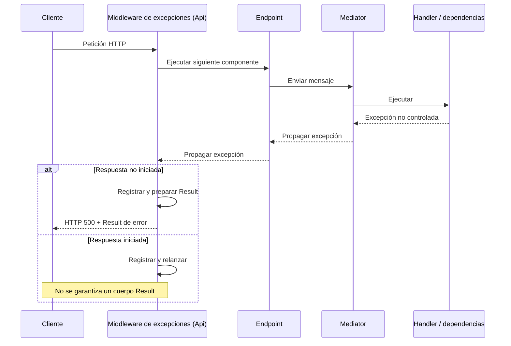

# TAREA-005 — Contrato Result en Api y manejo global de excepciones

- **Objetivo:** definir un contrato de respuesta para Api y el flujo de excepciones no controladas.
- **Rol:** Ideas.
- **Fecha:** no disponible en el contexto; pendiente de consignar.
- **Estado:** borrador de ADR propuesto, pendiente de aprobación.
- **Identificación:** TAREA-005, indicada expresamente por el usuario para el guardado.

## Requisitos confirmados y decisiones humanas

- El contrato incluye `IsSuccess`, `Message` y `Data`.
- `IsSuccess` es un booleano siempre presente.
- `Message` y `Data` aparecen siempre, incluso cuando sean `null`.
- `Message` puede ser `null` tanto en éxito como en fallo. Esta aclaración reemplaza la propuesta inicial de exigir un mensaje en los errores.
- `Data` puede ser `null`, incluidos los éxitos sin contenido.
- El contrato se utilizará exclusivamente en Api, no en los mensajes ni en las respuestas de Mediator.
- El objetivo es uniformar las respuestas de toda la API.
- El usuario solicitó generar el ADR y guardarlo con el identificador 005. Esta autorización de guardado no implica aprobación de la arquitectura propuesta.

## Borrador de ADR — Result en Api y manejo global de excepciones

### Contexto

Se necesita un formato uniforme de respuesta y un tratamiento seguro de excepciones no controladas. Devolver `Result` desde un behavior de Mediator exigiría compatibilidad con los tipos de respuesta de los mensajes y ampliaría el alcance más allá de Api.

### Decisión propuesta

Definir un contrato inmutable `Result<T>` en Api y centralizar el tratamiento de excepciones inesperadas mediante un middleware de esa capa. El middleware se situará antes de los componentes que deba proteger y envolverá la ejecución del siguiente componente.

Ante una excepción inesperada, si la respuesta no ha comenzado:

1. Registrar el error conforme a las reglas de seguridad, sin incorporar secretos ni datos sensibles.
2. Establecer HTTP `500`.
3. Generar `IsSuccess = false`, `Message` con un mensaje genérico seguro o `null`, y `Data = null`.
4. Conservar los campos nulos durante la serialización.

No devolver directamente `exception.Message` ni trazas para excepciones inesperadas. El mensaje será informativo; los consumidores no deberán interpretar su texto para tomar decisiones programáticas.

#### Flujo propuesto

#### Alcance y límites

- Las respuestas normales pasarán sin modificaciones.
- El middleware no reescribirá todos los cuerpos ni envolverá descargas o streaming.
- Si la respuesta ya ha comenzado, no sustituirá sus cabeceras ni su cuerpo; relanzará la excepción.
- Las cancelaciones del cliente tendrán tratamiento separado y no se convertirán automáticamente en HTTP `500`.
- Los errores HTTP sin excepción no quedarán cubiertos por el `try/catch`.
- Mediator conservará sus contratos actuales.

Este mecanismo cubre las excepciones inesperadas, pero no satisface por sí solo el objetivo de uniformar toda la API.

### Alternativas

| Alternativa | Complejidad y coste | Mantenimiento y pruebas |
|---|---|---|
| Middleware en Api | Centraliza el tratamiento sin cambiar contratos de Application. | Requiere pruebas de integración y tratamiento adicional para otras respuestas. |
| Behavior de Mediator que devuelve Result | Exige adaptar los contratos de respuesta; no cubre errores fuera de Mediator. | Aumenta el alcance y el número de contratos afectados. |
| Captura en cada endpoint | Sencilla de forma aislada, pero duplica lógica. | Favorece inconsistencias y repite pruebas de manejo de errores. |
| Middleware que reescribe todos los cuerpos | Mayor complejidad y posibles buffers. | Complica archivos, streaming y respuestas ya envueltas. |

**Recomendación:** middleware para excepciones, sin reescritura general de cuerpos. No constituye una decisión aprobada.

### Consecuencias

Positivas: el contrato permanece en Api, se reduce la duplicación del manejo de errores inesperados, se conserva la semántica HTTP y se evita exponer detalles internos.

Costes: la uniformidad completa requiere mecanismos adicionales; deben probarse cancelaciones y respuestas iniciadas; los consumidores deben interpretar el código HTTP junto con `IsSuccess`.

### Criterios de aceptación propuestos

- Una excepción inesperada anterior al inicio de la respuesta devuelve HTTP `500` con los tres campos de Result.
- `Message` y `Data` se serializan aunque sean `null`.
- No se exponen trazas, secretos ni detalles internos.
- Las respuestas normales no se modifican.
- No se intenta escribir una segunda respuesta.
- Una cancelación del cliente no se convierte automáticamente en HTTP `500`.
- Los contratos de Mediator no incorporan Result.

## Supuestos y dudas pendientes

- `Result<T>` inmutable es una propuesta; no se ha confirmado la forma concreta del contrato.
- Falta elegir cómo formatear éxitos: endpoints o filtros.
- Falta definir el tratamiento de validación y otros errores esperados.
- Falta cubrir `401`, `403` y `404` generados sin excepción.
- Falta acordar el tratamiento de `204`, descargas y streaming. HTTP `204` no admite cuerpo; mantener Result en todos los éxitos requeriría revisar su uso.
- Falta elegir un mensaje genérico o `null` para errores inesperados.
- No se ha aprobado una tabla de correspondencia entre excepciones esperadas y códigos HTTP.

## Fuentes y comprobaciones

- Instrucciones del proyecto `.github/copilot-instructions.md`, proporcionadas en el contexto.
- `docs/informes/README.md` y `docs/informes/indice.md`, consultados mediante las herramientas disponibles.
- Requisitos y aclaraciones del usuario en esta conversación.
- No se ha revisado código para verificar la implementación existente.
- No se han ejecutado comandos, compilaciones ni pruebas.
- No se dispone de un listado de carpetas; el ID de guardado procede de la indicación expresa del usuario.
- No se ha creado un ADR separado en `docs/adr`; este rol conserva el borrador en su informe.

## Siguiente paso

Revisar y aprobar o ajustar la decisión propuesta y resolver las dudas pendientes antes de implementar. La inscripción de la tarea y el guardado no equivalen a una aprobación humana del diseño.